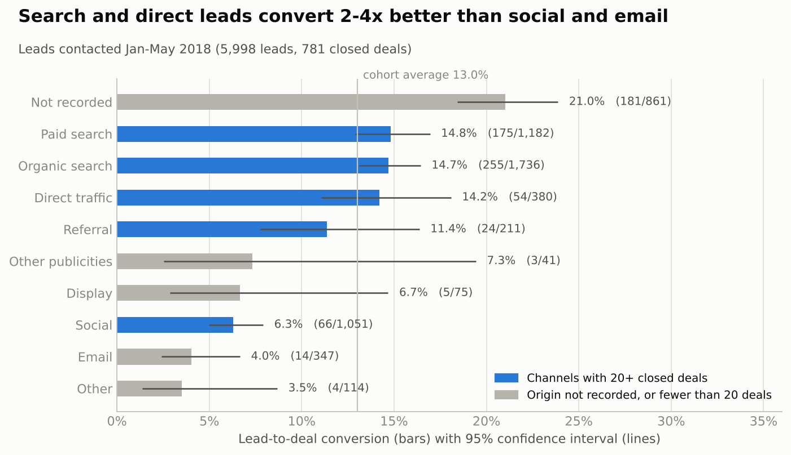
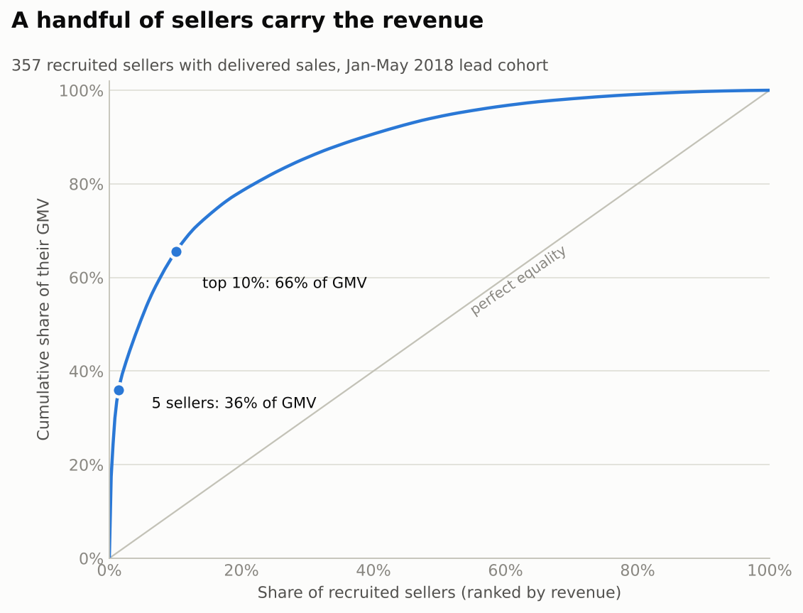
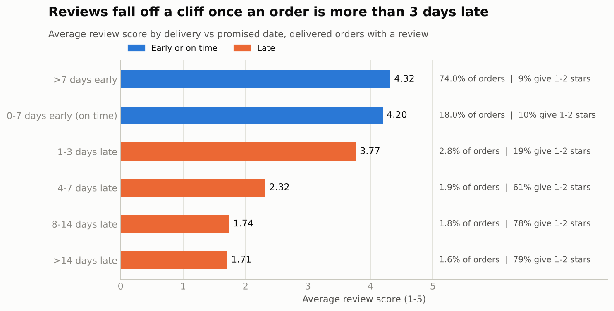
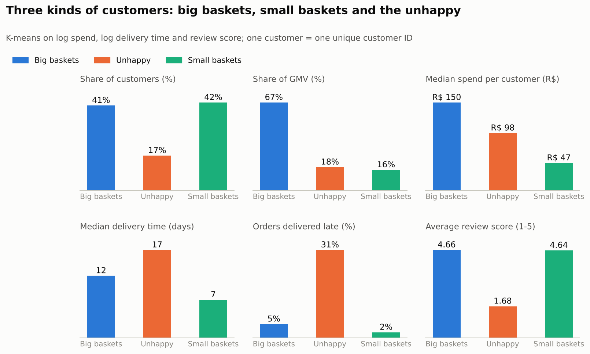

# Olist: acquisition funnel and customer satisfaction (SQL + Python)

Where should a Brazilian e-commerce marketplace invest to grow: in **which channels it recruits sellers from**, or in **which parts of the customer experience it fixes first**? This project answers both with SQL (SQLite) and Python on two public Olist datasets: about 100k orders (2016-2018) and 8,000 qualified marketing leads.

SQL does the heavy lifting (joins, CTEs, window functions) and Python adds what SQL is bad at: confidence intervals, a significance test, clustering and the charts.

## Key findings

1. **Search converts, social and email do not.** Paid search (14.8%), organic search (14.7%) and direct traffic (14.2%) turn leads into closed deals 2-4x more often than social (6.3%) or email (4.0%). 95% Wilson confidence intervals; 5,998 leads, 781 deals.
2. **Landing pages matter inside organic search.** Two pages convert at 25.0% against 10.3% for all other organic leads. In paid search there is no difference. (Observational: needs an A/B test.)
3. **Revenue from recruited sellers is extremely concentrated.** Five sellers produce 36% of the GMV (median seller R$ 538, mean R$ 1,806; one seller alone is 17.4%). Revenue per lead therefore cannot rank channels reliably; conversion rate can.
4. **Late deliveries destroy reviews, but only beyond 3 days.** On-time orders average 4.20 stars; 4+ days late falls to 2.3 and below. The 8% of orders that arrive late produce 34% of all 1-2 star reviews, and the effect holds inside each of the six largest states and five largest categories. 74% of orders arrive more than a week *before* the promised date, so estimates are padded.
5. **Satisfaction does not predict coming back.** 97% of customers buy once. Repeat purchase within 180 days is about 3% whether the first review was 1-2 or 4-5 stars (difference +0.01 pp, 95% CI -0.42 to +0.44, p = 0.96).
6. **Unhappy customers are not only a logistics problem.** K-means finds three segments; the "unhappy" one is 17% of customers and 18% of GMV, and about 70% of them received an *on-time* delivery, which points to product or seller quality.

<p>


</p>
<p>


</p>

The full analysis, with the reasoning behind each chart and the recommendations, is in [`notebooks/olist_marketing_analysis.ipynb`](notebooks/olist_marketing_analysis.ipynb) (outputs included, so it renders on GitHub).

## Repository structure

```
sql/
  01_schema.sql           relational schema: keys, types, indexes
  02_views.sql            shared business rules as views (delivered orders, funnel, cohort)
  queries/
    03_funnel.sql         7 funnel queries (channels, value per lead, segments, trend, landing pages...)
    04_customers.sql      7 customer queries (delay vs review, states, categories, repeat purchase...)
src/
  build_db.py             builds data/olist.db from the Kaggle CSVs, with documented cleaning
  run_queries.py          runs the named queries of a .sql file
notebooks/                analysis notebook (SQL + Python + charts)
reports/figures/          the 7 charts as PNG
```

## Reproduce it

1. Download both datasets from Kaggle (free account) and unzip all CSVs into `data/raw/`:
   - [Brazilian E-Commerce Public Dataset by Olist](https://www.kaggle.com/datasets/olistbr/brazilian-ecommerce) (9 CSVs)
   - [Marketing Funnel by Olist](https://www.kaggle.com/datasets/olistbr/marketing-funnel-olist) (2 CSVs)
2. `pip install -r requirements.txt`
3. `python src/build_db.py --raw data/raw` creates `data/olist.db` (about 10 seconds).
4. `python src/run_queries.py sql/queries/03_funnel.sql` (or `04_customers.sql`) prints every query.
5. `jupyter notebook notebooks/olist_marketing_analysis.ipynb` re-runs the analysis and regenerates the figures.

Tested with Python 3.13, pandas 3.0, NumPy 2.5, Matplotlib 3.11, SciPy 1.18 and scikit-learn 1.9.

## SQL techniques used

CTEs; window functions (`ROW_NUMBER`, `RANK`, `NTILE`, `LAG`, running `SUM`, moving `AVG`); median emulation in SQLite; aggregation *before* joins to avoid row fan-out; reusable views; composite primary keys and a foreign-key check on load.

## Methodological decisions

- **Customer = `customer_unique_id`.** `customer_id` changes with every order, so using it would hide repeat buyers.
- **Funnel cohort = leads contacted Jan-May 2018.** Closed deals only start on 5 Dec 2017, so 2017 leads look artificially bad (2-5% conversion vs 12-15%). The comparison cohort had at least five months to close.
- **Revenue = GMV** (item price of delivered orders), not Olist's commission, which is not in the data.
- **"Unknown" origin** (14% of leads) is kept separate and never used to draw conclusions; it is also a tracking problem worth fixing.
- **Channels with fewer than 20 deals** are shown but not ranked.
- **Segmentation** is K-means on log spend, log delivery time and review score, because 97% of customers buy once and RFM frequency carries no information. Silhouette favours k = 2 (a trivial split), so I chose the best k between 3 and 4 for actionable segments.

## Limitations

- Observational data from 2016-2018: findings are associations, not proven causes.
- Only Olist purchases are visible, so repeat behaviour elsewhere is unseen.
- Display, other and other publicities have too few deals to be ranked.
- K-means segments depend on the chosen features and scaling.

## Data and licences

The data is **not** included in this repository. It is published by Olist on Kaggle.

- **Data licence:** _to be confirmed from the Kaggle page of each dataset before publishing this repository._
- **Code licence:** _to be chosen (for example MIT)._

## Author

David · [LinkedIn](https://www.linkedin.com/in/YOUR-HANDLE)
